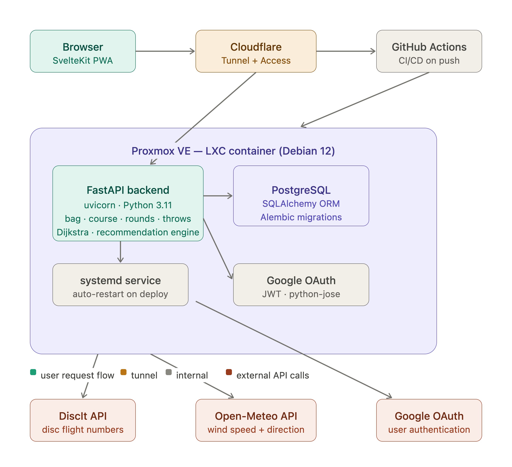

# HyzerPath


HyzerPath is an intelligent disc golf caddie. It models each hole as a fairway polygon, derives the optimal playing line from tee to basket with computational geometry, and recommends specific discs from the player's bag for each throw based on their personal measured throw distances. It is live at [hp.rmccue.dev](https://hp.rmccue.dev).

## Tech stack

**Backend**
- Python, FastAPI
- PostgreSQL, SQLAlchemy, Alembic
- Google OAuth, JWT auth

**Frontend**
- SvelteKit 2, Svelte 5, TypeScript
- Tailwind CSS v4
- MapLibre GL, PWA

**Infrastructure**
- Docker (multi-stage builds, multi-arch images on GitHub Container Registry)
- Kubernetes (single-node k3s on a Proxmox homelab), Helm
- ArgoCD (GitOps continuous delivery), GitHub Actions (CI)
- Traefik ingress, nginx, Cloudflare Tunnel

**External APIs**
- Open-Meteo (real-time wind data, no auth required)
- DiscIt API (disc flight number database, write-through PostgreSQL cache)

## How it works

Each hole is a fairway polygon drawn on a satellite map, plus real physical points: tee, basket, mandos, and hazard areas (OB, water, trees). There is no hand-authored path — the playing line is derived from the shape of the fairway itself.

To plan a hole, the engine carves hazards out of the playable area, shrinks it by a safety margin set by the play mode (conservative routes down the middle, aggressive hugs the inside of doglegs), then finds the shortest path through what remains with a visibility graph and Dijkstra. If the margin pinches the fairway shut, it backs off until a route exists — that surviving margin is the hole's honest tightness.

The engine then walks the line into individual throws — a flight can shape around a bend but never wrap a hard corner — and scores every disc per throw on distance fit, the shape the corridor demands, and measured clearance to the fairway edge, evaluating both backhand and forehand from the player's per-style distances. Each throw returns a disc, a shot shape, a landing target on the map, and a goal set by the play mode — from a safe par putt to a Circle 1 birdie look.

Throw distances come from the player: a field measuring mode records GPS start and end points per throw, tagged backhand or forehand, feeding the per-disc, per-style averages the engine reads. Wind from Open-Meteo is folded into effective distance at round start.



## Key engineering decisions

- **Fairway as a polygon, line as geometry.** Course mappers draw the playable area; the route, hole length, doglegs, and tightness are all derived from the shape. Nothing to keep consistent by hand, and a whole class of chain-mapping bugs is structurally impossible.
- **Risk mode as erosion.** One geometric parameter — how far the route stays from the fairway edge — replaces a pile of per-mode penalty constants, and degrades honestly on tight holes.
- **Fairway-aware disc selection.** Disc choice weighs measured corridor clearance against each disc's lateral movement and reach, so a tunnel gets a controllable disc and an open hole the longer one.
- **Recovery shots.** A lie outside the fairway is detected geometrically and the first recommendation becomes a pitch-out back into play.
- **Git as the source of truth for deployments.** ArgoCD continuously reconciles the cluster against the Helm chart in this repo; a deploy is a one-line tag change, and manual drift on the cluster is reverted automatically.
- **Migrations before rollouts.** Alembic runs as a pre-upgrade hook using the same image as the backend; if a migration fails, the new version never rolls out.
- **Readiness that means something.** The `/health` endpoint checks the database, so a pod only receives traffic once it can actually serve requests, and a broken release stalls instead of replacing working pods. A `preStop` hook drains in-flight requests for zero-downtime rollouts.
- **Structured JSON logging.** Logs are emitted as JSON to stdout (read with `kubectl logs`), with request method, path, status, and latency on every line; readiness-probe traffic is filtered out.

## Deployment

```
push to main
  → GitHub Actions: tests → build amd64 + arm64 images → ghcr.io (tagged sha-<commit>)
  → bump the tag in charts/hyzerpath/values-homelab.yaml
  → ArgoCD syncs: migration job → rolling update gated by readiness probes
  → Traefik → Cloudflare Tunnel → hp.rmccue.dev
```

Postgres runs as a StatefulSet with persistent storage, managed separately from the app chart so that app operations can never touch the database. Secrets are created out of band and never committed.

**On scale:** Kubernetes is far more infrastructure than an app with a handful of users needs; a single container would serve it fine. It runs on Kubernetes deliberately, as a hands-on way to learn to build and operate the full stack — containers, Helm, GitOps, and a real production cutover from the previous LXC deployment.

## Repository layout

| Path | Contents |
|---|---|
| `backend/` | FastAPI app, Alembic migrations, tests, Dockerfile |
| `frontend/` | SvelteKit app, nginx config, Dockerfile |
| `charts/hyzerpath/` | Helm chart; `values.yaml` for local k3d, `values-homelab.yaml` for production |
| `k8s/` | Namespace and Postgres, kept outside the chart on purpose |
| `platform/argocd/` | ArgoCD install values and the HyzerPath Application |
| `compose.yaml` | Full local stack with Docker Compose |

## Local development

**Full stack with Docker Compose** — create `compose.env` at the repo root (gitignored) with `GOOGLE_CLIENT_ID`, `GOOGLE_CLIENT_SECRET`, `REDIRECT_URI=http://localhost:8080/api/auth/callback`, `FRONTEND_URL=http://localhost:8080`, `JWT_SECRET`, and `ADMIN_EMAILS`, then:

```bash
docker compose up -d --build
```

The app is served at `http://localhost:8080`; migrations run automatically before the backend starts.

**Backend:**
```bash
cd backend
python -m venv .venv && source .venv/bin/activate
pip install -r requirements.txt -r requirements-dev.txt
alembic upgrade head
uvicorn app.main:app --reload
```

**Tests** (set a `JWT_SECRET` in `backend/.env` first):
```bash
cd backend && pytest
```

**Frontend:**
```bash
cd frontend
npm install
npm run dev
```

## Project status

Live at [hp.rmccue.dev](https://hp.rmccue.dev), running on a single-node k3s cluster in a Proxmox homelab and deployed through ArgoCD. Migrated from a hand-managed LXC container in November 2026. Seeded with test course data. GPS-based round tracking is functional and the recommendation engine is fairway-aware with risk-mode landing targets.